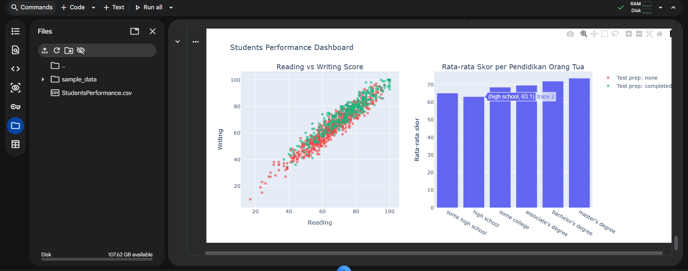
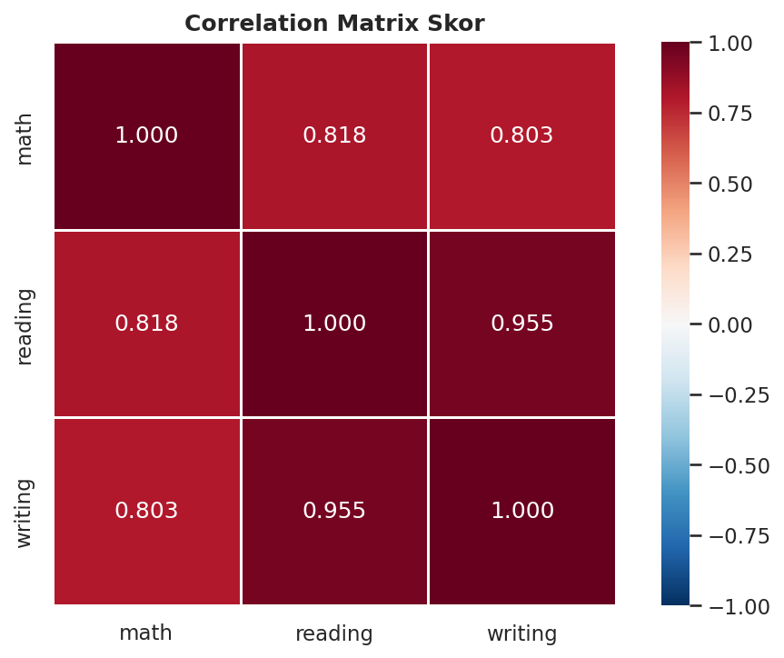
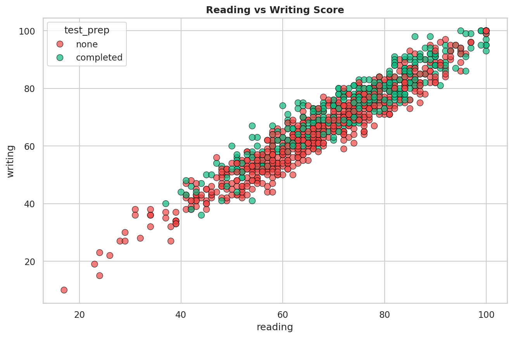
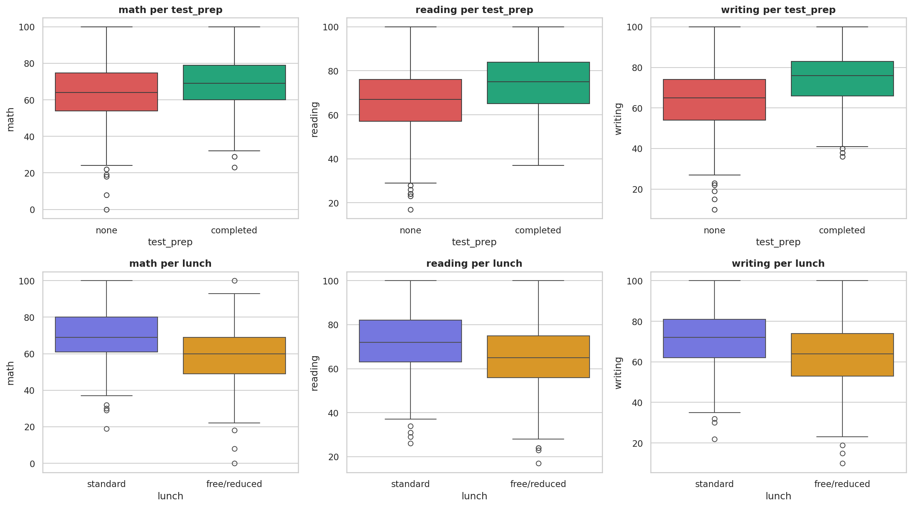

# Milestone 1: EDA Students Performance in Exams

## Deskripsi Dataset
Dataset berisi 1000 siswa dengan 8 kolom: gender, race/ethnicity,
parental level of education, lunch, test preparation course, serta
skor math, reading, dan writing.

Sumber: Kaggle, "Students Performance in Exams" (Jakki Seshapanpu).
Link: https://www.kaggle.com/datasets/spscientist/students-performance-in-exams

## Cara Menjalankan
1. Buka notebook di Google Colab.
2. Upload file StudentsPerformance.csv ke sesi Colab.
3. Jalankan semua sel (Runtime > Run all).

## Ringkasan Insight
- Data bersih (tanpa missing value dan duplikat), distribusi skor
  simetris, outlier hanya di sisi bawah.
- Siswa yang menyelesaikan test prep memiliki skor lebih tinggi di
  semua mata ujian (writing 74,42 vs 64,50).
- Siswa dengan lunch standard memiliki skor lebih tinggi, selisih
  terbesar di math (70,03 vs 58,92).
- Perempuan unggul di reading dan writing, laki-laki unggul di math.
- Korelasi reading-writing sangat kuat (0,955).
- Rata-rata skor naik seiring tingkat pendidikan orang tua
  (63,10 hingga 73,60).

## Hipotesis Milestone 2
- H1 (t-test): skor writing berbeda antara test_prep completed vs none.
- H2 (t-test): skor math berbeda antara lunch standard vs free/reduced.
- H3 (ANOVA): avg_score berbeda antar tingkat pendidikan orang tua.

## Screenshot

## Struktur Repo
- `Milestone1_EDA_StudentsPerformance.ipynb`: analisis EDA lengkap
- `StudentsPerformance.csv`: dataset
- `dashboard.png`, `heatmap.png`, `scatter.png`, `boxplot_kelompok.png`: hasil visualisasi

## Milestone 3: Sampling Distribution & Confidence Interval

**Dataset:** Students Performance (1.000 siswa)  

**Metrik utama:** skor writing | **Grup:** test preparation course (completed vs none)

### Ringkasan Hasil
- **Sampling distribution:** SE empiris mendekati SE teori (σ/√n) untuk n = 30, 100, 300 (mis. n = 300: 0,864 vs 0,877).
- **CI 95% rata-rata writing (semua siswa):** rumus [67,11; 69,00] vs bootstrap [67,10; 69,01]. Hampir identik.
- **CI 95% selisih (completed - none):** 9,91 poin. Rumus Welch [8,10; 11,72], bootstrap [8,13; 11,69]. Tidak memuat 0. Cohen's d = 0,69.
- **Power analysis (MDE 3 poin):** power = 88%, MDE terkecil terdeteksi (power 80%) = 2,67 poin. Data cukup.
- **Rekomendasi:** SHIP. Dorong siswa mengikuti test prep.
- **Catatan risiko:** data observasional (bukan bukti kausal), faktor pengganggu belum dikendalikan, analisis baru pada skor writing.

**Notebook:** [Milestone3_Sampling_CI_StudentsPerformance.ipynb](https://github.com/NabilaAdhelia/statistika-probabilitas-uniska/blob/main/Milestone3_Sampling_CI_StudentsPerformance.ipynb)
